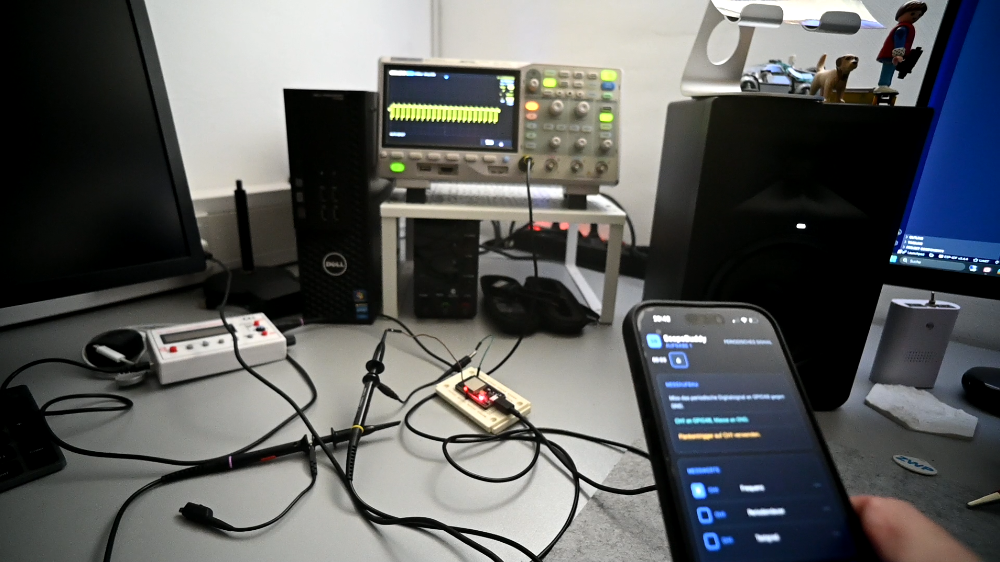

# HeadlessScopeBuddy by AndyCGN

HeadlessScopeBuddy turns a bare ESP32 DevKit V1 (30-pin, ESP-WROOM-32) into a
hands-on oscilloscope trainer. It generates real 3.3 V digital signals, presents
randomized measurement tasks, and reveals the expected values on demand. The
device has no display of its own: it opens a Wi-Fi access point and serves the
entire user interface as a web page, browsable from any phone, tablet, or
computer.



Firmware 0.6.0 provides 15 single- and dual-channel lessons, operated entirely
through the web UI.

## Credit

HeadlessScopeBuddy is a derivative of **[ScopeBuddy](https://johannesboernsen.github.io/ScopeBuddy/)**
by **Johannes Börnsen** — all lesson content, signal-generation logic, and the
original project design originate there. This variant replaces its
ESP32-P4/touchscreen hardware and LVGL UI with a plain ESP32 DevKit V1 and a
browser-based web UI; everything else builds on that original work. Many
thanks to Johannes Börnsen for making ScopeBuddy available. See
[LICENSE.md](LICENSE.md) for the licensing terms this derivative operates
under.

> The original ESP32-P4/CrowPanel board-support code (`peripheral/bsp_display`,
> `bsp_illuminate`, `bsp_i2c`, `bsp_stc8h1kxx`) and its LVGL UI
> (`main/ui/`, `main/encoder_input.c`) remain in the repository but are no
> longer part of the default build; see [ENCODER.md](ENCODER.md) for the
> CrowPanel-specific wiring notes that still apply to that hardware.

## What you need

| Component            | Requirement                                                                                       | References and sources                                                                       |
| -------------------- | ------------------------------------------------------------------------------------------------- | -------------------------------------------------------------------------------------------- |
| Board                | ESP32 DevKit V1, 30-pin, ESP-WROOM-32 module, 4 MB flash                                          | Any common clone board                                                                       |
| Oscilloscope         | One channel for the basic lessons; two channels for all lessons                                   | Use high-impedance inputs and probes suitable for 3.3 V logic                                |
| USB cable            | USB data cable for installing the firmware                                                        | Charge-only cables do not work                                                               |
| Wi-Fi client         | Phone, tablet, or computer with a browser                                                         | Connects to the HeadlessScopeBuddy access point to display the UI                            |
| Enclosure (optional) | 3D-printable ScopeBuddy enclosure (designed for the CrowPanel variant; check fit before printing) | [STL model](hardware/enclosure/ScopeBuddy.stl) · [Model notes](hardware/enclosure/README.md) |

## Assemble the hardware

1. Connect oscilloscope CH1 to `GPIO25`. For two-channel lessons, connect CH2
   to `GPIO26`. Connect both probe grounds to board `GND`.

GPIO25 and GPIO26 are 3.3 V logic outputs intended only for high-impedance
oscilloscope or logic-analyzer inputs. Do not connect loads or external
voltages to these pins.

## Install HeadlessScopeBuddy

HeadlessScopeBuddy is installed by building the firmware from source and
flashing it over USB; see [Build from source](#build-from-source) below.

After flashing, HeadlessScopeBuddy opens a Wi-Fi access point named
**HeadlessScopeBuddy** (password `scopebuddy` by default; change it via
`idf.py menuconfig` under "HeadlessScopeBuddy Web UI" before flashing).
Connect to it and open `http://headlessscopebuddy.local/` or
`http://192.168.4.1/` in a browser to use the trainer.

## Run the first hardware check

HeadlessScopeBuddy includes two diagnostic signals for checking a newly
assembled device and its oscilloscope connections:

1. Open **Settings → Diagnostics → Hardwaretests → 1-Kanal-Test**. GPIO25
   should output 1 kHz at 50% duty cycle.
2. Open **Hardwaretests → 2-Kanal-Test**. Both channels should output 1 kHz
   at 50% duty cycle, with GPIO26 following GPIO25 by 100 µs.

Stopping a test or leaving its page drives the outputs LOW. Detailed expected
measurements and the validation record are in
[Hardware validation](docs/HARDWARE_VALIDATION.md).

## Lessons

Selecting a lesson starts an open-ended series of randomized tasks.
HeadlessScopeBuddy avoids repeating any of the ten most recent signal
configurations in that series. The return-to-start confirmation can be
disabled in the settings.

Single-channel lessons on GPIO25:

- Periodic signal
- Pulse widths
- Burst
- Missing pulse
- Servo signal
- Tachometer signal
- Button bounce
- UART 8N1
- Alternating states

Dual-channel lessons on GPIO25 and GPIO26:

- Trigger/response
- Phase shift
- Frequency divider
- Ultrasonic echo
- Gated PWM
- Quadrature encoder

# New in v0.6.3
## Enhancements & ESP32-WROOM-32 Improvements

This build includes several hardware compatibility fixes and usability extensions for standard **ESP32-WROOM-32** boards (such as ESP32 DevKit V1 and ESP32 D1 Mini):

* **ESP32-WROOM-32 Signal Generation Compatibility:**
  * Cleanly releases RMT TX channels and encoders (`rmt_del_channel` / `rmt_del_encoder`) when stopping sequences to prevent ESP-IDF 5.4+ GPIO 25 reservation conflicts when switching between RMT and LEDC/PWM lessons.
  * Uses `64` RMT memory block symbols and conditionally guards `rmt_new_sync_manager` via `SOC_RMT_SUPPORT_TX_SYNCHRO` so all single- and dual-channel tests and lessons run reliably on the classic ESP32.
* **Wi-Fi Client Mode (WPA2 / DHCP) with SoftAP Fallback:**
  * On startup, HeadlessScopeBuddy attempts to connect to a configured 2.4 GHz WPA2 network using automatic channel scanning and DHCP.
  * If no network is configured or the router is unreachable, it automatically falls back to its built-in access point (**`HeadlessScopeBuddy`**, password `scopebuddy`, reachable at `http://192.168.4` or `http://headlessscopebuddy.local`).
  * Credentials can be configured or reset directly in the browser under **Settings (`⚙`) → Wi-Fi Connection** and are stored persistently in NVS.
* **Real-World Application Examples:**
  * Every lesson card on the start screen includes a toggleable real-world oscilloscope use case, which is also shown in the measurement setup panel during active tasks.
* **Modular Multi-Language Web UI (`DE` / `EN`):**
  * Switch live between **German (`DE`)** and **English (`EN`)** using the language selector in the top bar.
  * Translations are stored in separate JSON files (`main/web/lang/de.json`, `main/web/lang/en.json`) embedded via `EMBED_TXTFILES`.

### Adding Further Languages

To add a new language (e.g., French `fr`) to the web UI:

1. **Create the translation file:** Copy `main/web/lang/en.json` to `main/web/lang/fr.json` (saved as UTF-8 without BOM) and translate all values, `examples`, `cText`, and `cPatterns` entries.
2. **Embed the file in CMake:** Add `"web/lang/fr.json"` to `EMBED_TXTFILES` in `main/CMakeLists.txt`.
3. **Serve the file in `main/web_server.c`:** Declare the `_binary_fr_json_start` / `_binary_fr_json_end` symbols and return them in `lang_handler()` when `/lang/fr.json` is requested.
4. **Register the language in `main/web/index.html`:** Add `'fr'` to `supportedLangs` and add `<option value="fr">FR</option>` inside `<select id="langSelect">`.
5. **Rebuild and flash:** Run `idf.py build flash`.

## New in v0.7.0

Version **0.7.0** expands HeadlessScopeBuddy from 15 to **23 oscilloscope training lessons** by adding 8 new single- and dual-channel exercises:

### New 1-Channel Lessons (CH1 / GPIO25)
* **Glitch / Noise Spike (`STÖRIMPULS (GLITCH)`):** Detect periodic narrow needle pulses inside a regular square wave using pulse-width triggering (base period, glitch pulse width, noise interval).
* **Manchester Code (`MANCHESTER-CODE`):** Decode self-clocking IEEE 802.3 mid-bit transitions into hex bytes (bit time, data rate, decoded byte).
* **LED Protocol NZR (`LED-PROTOKOLL (NZR)`):** Measure 0-bit and 1-bit high pulse widths of a 1-wire addressable LED bus such as WS2812B / NeoPixel (0-bit high time, 1-bit high time, data byte).
* **PWM Staircase Wave (`PWM-TREPPENWELLE`):** Analyze a 4-step modulated PWM ramp (20–80% duty cycle) used for analog voltage generation via RC low-pass filtering (carrier period, step duration, duty cycle span).

### New 2-Channel Lessons (CH1 / GPIO25 & CH2 / GPIO26)
* **SPI Bus Mode 0 (`SPI-BUS (MODE 0)`):** Measure `SCLK` clock frequency, `MOSI` setup time, and decode transmitted bytes on the rising clock edge.
* **Stepper Motor (`SCHRITTMOTOR (STEP/DIR)`):** Verify `STEP` pulse frequency, step count per packet, and `DIR` direction setup lead time before the first step pulse.
* **I2C Address Frame (`I2C-ADRESS-FRAME`):** Inspect START/STOP conditions, `SCL` clock frequency, 7-bit slave address, and R/W bit on `SCL` and `SDA`.
* **Half-Bridge Dead-Time (`HALBBRÜCKEN-TOTZEIT`):** Measure switching frequency, high-side pulse width, and the complementary dead-time interlock between high-side and low-side gate signals.

## Build from source

HeadlessScopeBuddy 0.6.0 is built with ESP-IDF 5.4.x. Install and activate
ESP-IDF, then run:

```sh
idf.py set-target esp32
idf.py menuconfig   # optional: change the Wi-Fi SSID/password under "HeadlessScopeBuddy Web UI"
idf.py build
idf.py flash monitor
```

ESP-IDF's component manager downloads the required `mdns` component on first
build.

If flashing reports `Wrong boot mode detected`, the board's auto-download
circuit isn't putting it into bootloader mode reliably: hold **BOOT**, tap
**EN**/**RST** once while still holding **BOOT**, keep holding **BOOT** until
the flash tool connects, then release it.

## License

Original ScopeBuddy contributions are available under the
[ScopeBuddy Community License 1.0](LICENSE.md). You may build, study, modify,
and publish them, including for education and research. Published modified
versions must provide their corresponding source, retain a reference to this
project, and use a distinct name.

ScopeBuddy devices and kits may be passed on at direct cost. Selling
them for profit requires a separate commercial license from the repository
owner. ScopeBuddy is therefore source-available, not Open Source as defined by
the Open Source Initiative.

Elecrow-derived board-support material and other third-party components are
not relicensed by ScopeBuddy. Their status and the exact repository license
boundaries are documented in [LICENSE.md](LICENSE.md) and
[THIRD_PARTY_NOTICES.md](THIRD_PARTY_NOTICES.md).

Contributions are welcome under the process in
[CONTRIBUTING.md](CONTRIBUTING.md). Pull requests must accept the
[Contributor License Agreement](CLA.md), which lets contributors retain their
copyright while allowing ScopeBuddy to continue offering separate commercial
licenses.

## Further documentation

- [Rotary encoder wiring](ENCODER.md)
- [Enclosure model and dimensions](hardware/enclosure/README.md)
- [Hardware diagnostics and validation](docs/HARDWARE_VALIDATION.md)
- [Maintainer and release guide](docs/MAINTAINING.md)

[crowpanel-product]: https://www.elecrow.com/crowpanel-advanced-5inch-esp32-p4-hmi-ai-display-800x480-ips-touch-screen-with-wifi-6.html
[crowpanel-wiki]: https://www.elecrow.com/wiki/CrowPanel_Advanced_5inch_ESP32-P4_HMI_AI_Display_800x480_IPS_Touch_Screen_with_WiFi_6.html
[crowpanel-amazon]: https://amzn.eu/d/075Lfm2j
[encoder-amazon]: https://amzn.eu/d/03NJfjfa
